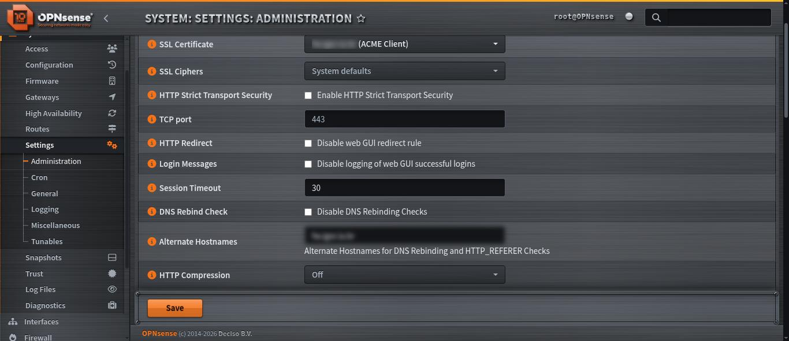

# OPNsense theme: Forja

A dark theme for the OPNsense web GUI: brushed steel plates, rivets and orange accents, for desktop and mobile.
CSS only: it changes how the GUI looks and nothing else (no JavaScript, no PHP, no configuration changes).

Made to celebrate 10 years of OPNsense, as a thank-you to the project and its community. Proposed upstream in
[opnsense/plugins#5921](https://github.com/opnsense/plugins/issues/5921).

> Independent project, not affiliated with or supported by the OPNsense project or Deciso B.V.

## Screenshots

| | |
|---|---|
|  |  |
|  |  |
|  |  |

The radar/map on the dashboard is the separate [Sonar widget](https://github.com/igortoledo007/opnsense-widget-sonar);
the theme works without it. Addresses and host names in the screenshots are blurred.

## Requirements

- OPNsense 26.7 or later (tested on 26.7.9, amd64).

## Installation

**As a package (recommended)**, on a FreeBSD/OPNsense build host with the official plugins tree:

```sh
git clone https://github.com/opnsense/plugins.git
git clone https://github.com/igortoledo007/opnsense-theme-forja.git
cp -R opnsense-theme-forja/theme-forja plugins/misc/theme-forja
cd plugins/misc/theme-forja
make package        # -> work/pkg/os-theme-forja-<version>.pkg
```

Copy the package to the firewall and install it with `pkg add ./os-theme-forja-<version>.pkg`.

**Manual copy (test boxes):**

```sh
scp -r theme-forja/src/opnsense/www/themes/forja root@<firewall>:/usr/local/opnsense/www/themes/
```

Then select it in **System › Settings › General › Theme** and reload the page (Ctrl+Shift+R).

## Removal

Select another theme first (System › Settings › General › Theme), then `pkg delete os-theme-forja`, or delete
`/usr/local/opnsense/www/themes/forja` if it was copied by hand.

## Layout

```
theme-forja/                     plugin directory for the opnsense/plugins tree (misc/theme-forja)
  Makefile, pkg-descr
  src/opnsense/www/themes/forja/
    build/css/                   compiled stylesheets used by the GUI
    build/images/                theme images (logo, textures)
    assets/stylesheets/          SCSS sources
screenshots/
```

## AI disclosure

Written with AI assistance: Claude (Anthropic), a mix of the Fable 5.2 and Opus 5.5 models. I reviewed and tested it
on my own firewall and I maintain it.

## License

BSD 2-Clause, see [LICENSE](LICENSE). OPNsense® is a registered trademark of Deciso B.V.
