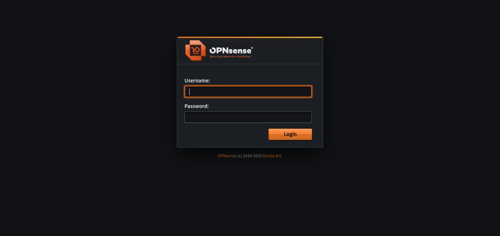
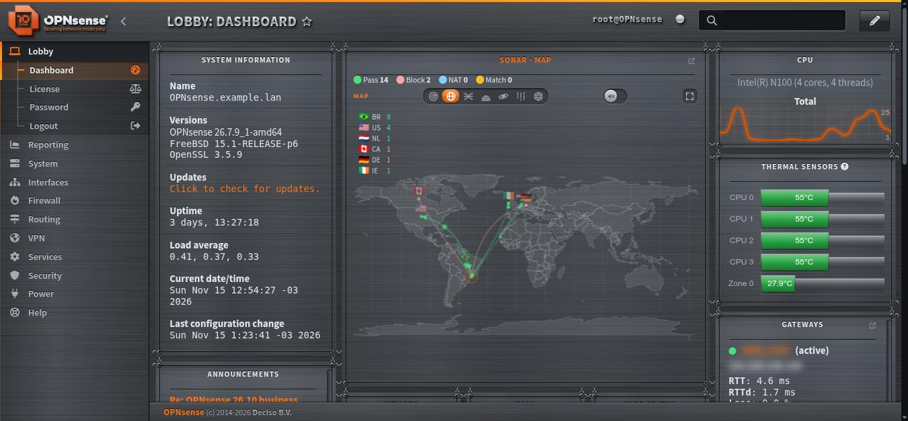
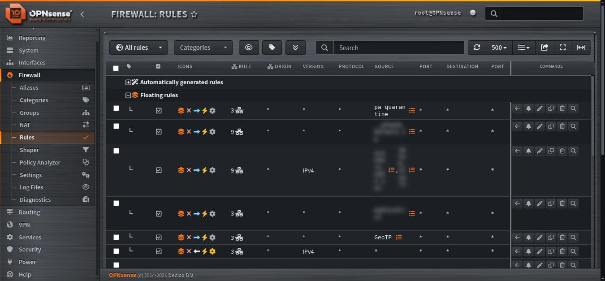
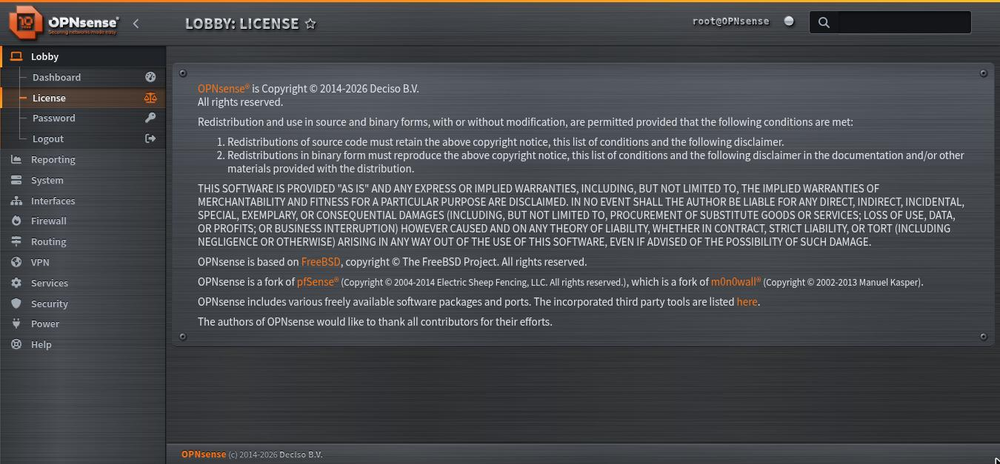
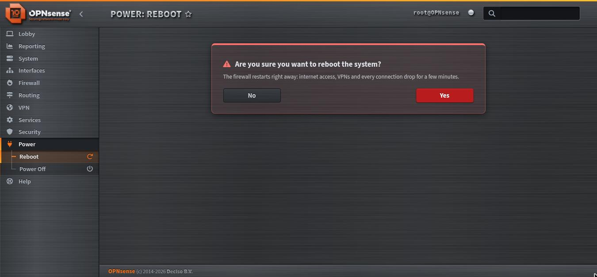
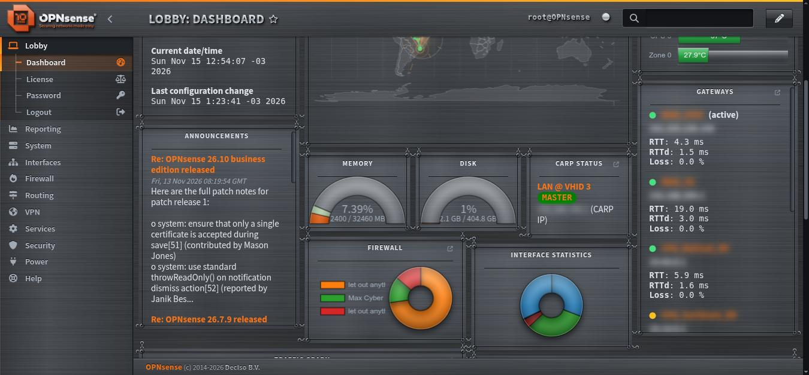
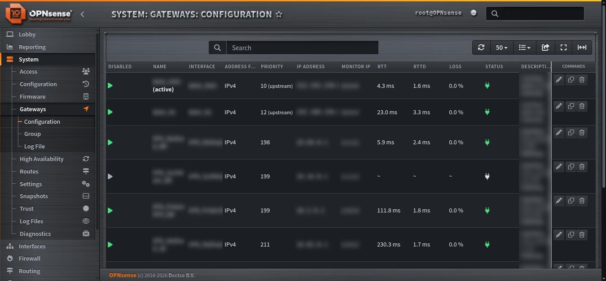
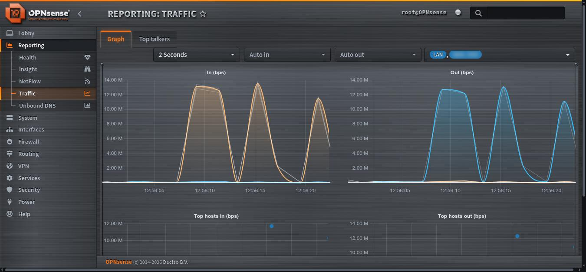
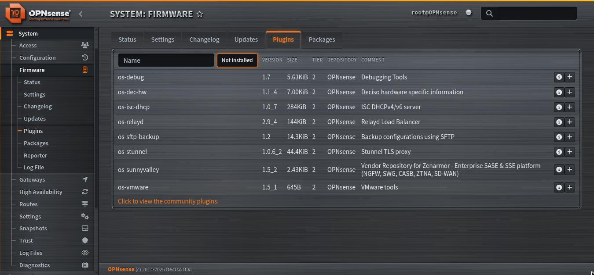

# OPNsense theme: Forja

A theme family for the OPNsense web GUI: brushed steel plates, rivets and orange accents, for desktop and mobile, in
three variants: **forja** (light), **forja-dark** and **forja-auto** (follows the light/dark setting of the system).

It changes how the GUI looks and behaves visually, nothing else: no PHP, no configuration changes, no network access.
Besides the stylesheets, a small `theme.js` adds the visual extras listed below.

Made to celebrate 10 years of OPNsense, as a thank-you to the project and its community. Proposed upstream in
[opnsense/plugins#5921](https://github.com/opnsense/plugins/issues/5921).

> Independent project, not affiliated with or supported by the OPNsense project or Deciso B.V.

## Screenshots

| | |
|---|---|
|  |  |
|  |  |
|  |  |
|  |  |
|  |  |

The radar/map on the dashboard is the separate [Sonar widget](https://github.com/igortoledo007/opnsense-widget-sonar);
the theme works without it. Addresses, host names and rule names in the screenshots are blurred.

## Visual extras (theme.js)

- **3D relief on the dashboard charts**: the pie/doughnut charts (firewall rules, interface statistics) and the
  memory and disk gauges get depth, light and shadow, and the empty part of gauges and bars follows the theme instead
  of a fixed light grey.
- **Tree navigation**: the left menu shows the menu levels as a tree.
- **Modern line charts** in Reporting › Traffic and Reporting › Unbound DNS: smooth thin lines with a gradient area.
- **Readable statistics**: Unbound DNS numbers in scientific notation, times as dates and durations.
- **Grids**: network data in monospace, touch-sized command buttons on mobile, and a filter (all / installed / not
  installed) in System › Firmware › Plugins.

Everything is client side and only touches the page appearance; removing the theme removes all of it.

## Requirements

- OPNsense 26.7 or later (tested on 26.7.9, amd64).

## Installation

**As a package (recommended)**, on a FreeBSD/OPNsense build host with the official plugins tree:

```sh
git clone https://github.com/opnsense/plugins.git
git clone https://github.com/igortoledo007/opnsense-theme-forja.git
cp -R opnsense-theme-forja/theme-forja plugins/misc/theme-forja
cd plugins/misc/theme-forja
make package        # -> work/pkg/os-theme-forja-<version>.pkg
```

Copy the package to the firewall and install it with `pkg add ./os-theme-forja-<version>.pkg`.

**Manual copy (test boxes):**

```sh
scp -r theme-forja/src/opnsense/www/themes/forja* root@<firewall>:/usr/local/opnsense/www/themes/
```

Then select **forja**, **forja-dark** or **forja-auto** in **System › Settings › General › Theme** and reload the page
(Ctrl+Shift+R).

## Removal

Select another theme first (System › Settings › General › Theme), then `pkg delete os-theme-forja`, or delete
`/usr/local/opnsense/www/themes/forja`, `forja-dark` and `forja-auto` if they were copied by hand.

## Layout

```
theme-forja/                     plugin directory for the opnsense/plugins tree (misc/theme-forja)
  Makefile, pkg-descr
  src/opnsense/www/themes/forja, forja-dark, forja-auto/
    build/css/                   compiled stylesheets used by the GUI
    build/js/theme.js            visual extras
    build/images/                theme images (logo, textures)
source/                          SCSS and JavaScript sources and build.sh (sassc)
screenshots/
```

## AI disclosure

Written with AI assistance: Claude (Anthropic), a mix of the Fable 5.2 and Opus 5.5 models. I reviewed and tested it
on my own firewall and I maintain it.

## License

BSD 2-Clause, see [LICENSE](LICENSE). OPNsense® is a registered trademark of Deciso B.V.
